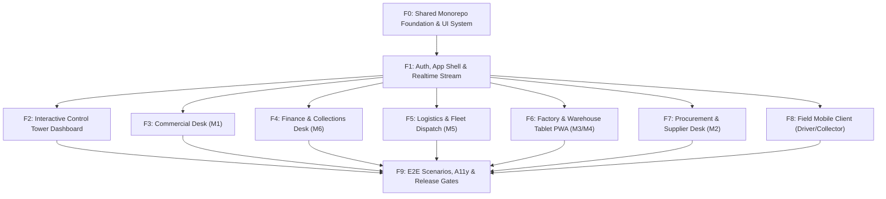

# Phase P3 — Frontend Product Delivery & Interactive Control Tower Plan

## 1. Executive Objective & Strategic Vision

Deliver the complete frontend product suite for **NeoBus** across its three target client surfaces, transforming backend APIs (Modules M0–M10) into an exceptionally attractive, hyper-interactive, and responsive business operating system:

1. **Office Desk Web App (`apps/web`)**: Dense, keyboard-fast, 0-mouse operational command center for Operations Coordinators, Sales Desks, and Finance Managers.
2. **Interactive Owner Control Tower & Executive Dashboard (`apps/web`)**: A visually stunning, glassmorphic, real-time command center providing mission-critical telemetry, dynamic cross-filtering analytics, live fleet tracking, and a zero-latency exception resolution workbench.
3. **Factory & Warehouse Tablet PWA (`apps/tablet`)**: Touch-first, high-contrast, offline-first progressive web application tailored for rugged 10" industrial tablets with large hit targets ($\ge 48\text{px}$), tactile numeric keypads, blind GRN receiving, and background IndexedDB sync.
4. **Field Mobile Client (`apps/mobile`)**: Native/PWA field application for Drivers and Collectors with offline ePOD (signatures, photos), turn-by-turn navigation handoff, and immediate cash receipting.

> **Zero-Code Phase Rule**: This document is an exhaustive implementation blueprint. No application source code is written until this plan is reviewed, refined, and signed off.

---

## 2. Visual Aesthetics & Interactive UX Architecture

To achieve an **exceptionally attractive** visual standard and **deeply engaging user interactivity**, the frontend design departs from sterile corporate tables, adopting modern telemetry design patterns inspired by aviation glass cockpits, modern trading desks, and high-end industrial control rooms.

### 2.1 Aesthetic Foundation & Design Language

| Aesthetic Element | Specification & Visual Treatment | Implementation Details |
|---|---|---|
| **Theme & Atmosphere** | **Dual Obsidian & Clean Slate**: Default **Obsidian Dark Mode** for Control Tower displays, wall boards, and executive night viewing; **Clean Slate Light Mode** with high contrast for sunlit office sales desks. | `dark:bg-zinc-950 bg-slate-50 text-slate-900 dark:text-zinc-100` |
| **Glassmorphism & Depth** | Layered translucent panels with multi-stop backdrop blurs, crisp 1px perimeter borders with subtle luminescence. | `backdrop-blur-md bg-white/70 dark:bg-zinc-900/60 border border-slate-200/60 dark:border-zinc-800/60 shadow-xl shadow-black/5` |
| **Vivid Semantic Accents** | Functional neon & jewel-tone glow accents indicating operational states: | <ul><li>**Emerald (`#10B981`)**: Positive margin, healthy yield, live connection, collected cash.</li><li>**Electric Indigo (`#6366F1`)**: Sales velocity, active work orders, confirmed shipments.</li><li>**Radiant Amber (`#F59E0B`)**: Below-floor price requests, credit holds, stock drift warnings.</li><li>**Vibrant Crimson (`#EF4444`)**: Overdue AR > 30d, rejected POs, disputed handovers, stockouts.</li></ul> |
| **Typography & Data Grid** | **Inter** for clean UI chrome, **JetBrains Mono / Tabular Nums** for all currency, quantities, and timestamps. **Noto Sans Devanagari** with calibrated 1.6x line-height for Marathi i18n. | Monospaced numeric alignment prevents layout shift during live data ticks. |
| **Micro-Interactions** | Tactile spring physics on button clicks, smooth layout animations when cards expand or reorder (`framer-motion`), soft audio chimes on high-value exception arrivals (toggleable). | `framer-motion` layoutId transitions, scale down `active:scale-98`. |

---

### 2.2 Hyper-Interactive Control Tower Dashboard Specification

```
┌─────────────────────────────────────────────────────────────────────────────────────────────────────────────┐
│ ⚡ NEOBUS CONTROL TOWER      [ Pune Central Plant ▾ ]   [ Today (Live) ▾ ]    🟢 SSE: LIVE (0.2s)    🔔 Alerts (3) │
├─────────────────────────────────────────────────────────────────────────────────────────────────────────────┤
│ ┌ Today's Sales ────────┐ ┌ Blended Margin ───────┐ ┌ In Custody ───────────┐ ┌ Pending Exceptions ───────┐ │
│ │ ₹4,82,450.00          │ │ 11.4%   ▲ +1.2%       │ │ ₹1,28,400.00          │ │ 3 Action Required   ▲     │ │
│ │ ▓▓▓▓▓▓▓▓▓▓░░░ 78% tgt │ │ [Low: 8.2% | High:15%]│ │ Cash: ₹95k | Chq:₹33k │ │ 2 Price | 1 Credit Hold │ │
│ │ ── hourly velocity ── │ │ ── margin by category │ │ ── driver breakdown ─ │ │ ⚡ Click to resolve      │ │
│ └───────────────────────┘ └───────────────────────┘ └───────────────────────┘ └───────────────────────────┘ │
├─────────────────────────────────────────────────────────────────────────────────────────────────────────────┤
│ ┌ MISSION CONTROL: LIVE PIPELINE ─────────────────────────────────────────────────────────────────────────┐ │
│ │ [① Confirmed (18)] ──> [② Production (6)] ──> [③ Loading (3)] ──> [④ In Transit (5)] ──> [⑤ Delivered (24)]│ │
│ │   ₹3,40,000              ₹1,85,000              ₹92,000              ₹1,64,000              ₹4,82,450     │ │
│ └─────────────────────────────────────────────────────────────────────────────────────────────────────────┘ │
├──────────────────────────────────────────────────────┬──────────────────────────────────────────────────────┤
│ ┌ ACTIVE FLEET & DISPATCH RADAR ───────────────────┐ │ ┌ EXCEPTION WORKBENCH (ZERO-LATENCY RESOLUTION) ────┐ │
│ │ 🚚 MH-12-Q-4401 (Ramesh) • Stop 4/8 • On Time   │ │ │ ⚡ PRICE OVERRIDE: SO-2026-0891 (ABC Traders)       │ │
│ │   [=== Progress 65% ===]  ETA next: 14 mins      │ │ │   500 kg Paneer @ ₹88.00 (Floor: ₹90, Target: ₹95) │ │
│ │ 🚚 MH-14-BA-1209 (Vijay) • Stop 7/7 • ⚠️ 20m Late│ │ │   Margin: 6.8% (Target: 12.0%) • Impact: ₹72,000   │ │
│ │   [========== 92% =====]  Cash on board: ₹24,500 │ │ │   Margin Simulator Slider: [──●──────] ₹89.50 (8.1%)│ │
│ │ [ 🗺️ Open Live Geospatial Map View ]              │ │ │   [ ✓ Approve ₹88 ] [ ⚡ Counter ₹89.50 ] [ ✕ Reject ]│ │
│ └──────────────────────────────────────────────────┘ └──────────────────────────────────────────────────────┘ │
├──────────────────────────────────────────────────────┬──────────────────────────────────────────────────────┤
│ ┌ REAL-TIME AR AGING WATERFALL ────────────────────┐ │ ┌ FACTORY BATCH MONITOR & YIELD FLOW ───────────────┐ │
│ │  Current (0-7d)  : ₹8,40,000  ▓▓▓▓▓▓▓▓▓▓▓▓▓      │ │ │ Batch B-2611-04 (Paneer 500kg) • Stage: Cooking     │ │
│ │  Due (8-15d)     : ₹3,10,000  ▓▓▓▓▓              │ │ │   Elapsed: 42m / 60m ⏱️ • Yield Variance: +0.4%     │ │
│ │  Overdue (16-30d): ₹1,45,000  ▓▓                 │ │ │ Batch B-2611-05 (Ghee 200kg) • Stage: Packing       │ │
│ │  Critical (30d+) : ₹85,000    █ (⚠️ 1-Click PTP) │ │ │   Elapsed: 15m / 30m ⏱️ • Yield Variance: -1.2% (OK)│ │
│ └──────────────────────────────────────────────────┘ └──────────────────────────────────────────────────────┘ │
└─────────────────────────────────────────────────────────────────────────────────────────────────────────────┘
```

#### Detailed Widget Specifications

1. **Executive Real-Time Pulse Header (Always-Visible Hero Bar)**:
   - **Live Telemetry Beacon**: Pulsing green dot showing SSE connection status (`LIVE — 0.2s lag`), auto-switching to amber (`POLLING — 30s fallback`) or red (`OFFLINE`).
   - **Metric 1: Today's Tax Invoices / Sales (OD-020)**: Large tabular font, animated number count-up on load/update (`useSpring`). Hover displays hourly run-rate sparkline. Click opens the Invoices Drawer.
   - **Metric 2: Blended Gross Margin (%)**: Real-time margin dial with chromatic threshold shifts (Red < 5% $\to$ Amber < 10% $\to$ Green $\ge 10\%$). Toggle button switches from aggregate margin to Category Margin breakdown.
   - **Metric 3: Cash & Cheques in Custody (OD-015)**: Dual-badge chip showing physical cash vs cheques held across all drivers/collectors. Click opens the Cashier Handover Reconciliation Drawer.
   - **Metric 4: Actionable Exception Counter (OD-002, OD-019)**: Pulsing crimson badge. Click triggers smooth slide-over of the Exception Workbench.

2. **Interactive Mission Control Pipeline**:
   - Visual 5-stage pipeline funnel (`Confirmed` $\to$ `Production` $\to$ `Loading` $\to$ `In-Transit` $\to$ `Delivered`).
   - **Interactive Filtering**: Clicking any stage instantly filters all dashboard widgets and the bottom drawer to records currently in that status.
   - Stage cards display live order counts, total valuation in INR, and SLA breach warnings.

3. **Active Fleet & Dispatch Telemetry Mini-Board**:
   - Live truck tracking cards showing vehicle number, driver name, current stop progress (e.g. `Stop 4 of 8`), and delay flags.
   - **Interactive Geospatial Drawer**: Clicking "Open Live Geospatial Map View" opens an interactive Leaflet/Mapbox modal with animated vehicle icons moving along planned routes, delivery stop pins color-coded by status (Green = Delivered, Amber = Active, Gray = Pending), and traffic overlays.

4. **Zero-Latency Exception Workbench**:
   - Exception cards render in real-time as `exception.requested` events arrive via SSE.
   - **Interactive Price Counter Slider**: When reviewing below-floor price overrides, a draggable slider enables the owner to test counter-offer values (e.g. ₹88 $\to$ ₹89.50) with instant, real-time recalculation of gross margin % and rupee profit impact before submitting.
   - **Quick Decision Hotkeys**: `A` to Approve, `C` to Counter, `R` to Reject with inline quick-reason chips (e.g. "Below raw material cost", "Competitor match verified").
   - **Biometric / PIN Overlay**: Modal PIN prompt for approvals exceeding ₹5,000 threshold (`OD-002`).

5. **Cross-Filtering AR Aging & Cash Flow Analytics**:
   - Interactive horizontal waterfall bars (0–7d, 8–15d, 16–30d, 30d+).
   - Clicking the `30d+ Critical` bar filters the customer ledger view to delinquent accounts, providing 1-click WhatsApp payment reminder dispatch (`OD-024`) and PTP (Promise-to-Pay) logging.

6. **Customizable Dashboard Grid & Kiosk Mode**:
   - Drag-and-drop widget layout allowing owners to pin preferred widgets.
   - **Wall-Board Kiosk Mode**: Fullscreen toggle (`F11`) with dark-theme contrast optimization and optional 60-second widget carousel rotation for operations room wall TVs.

---

## 3. Frontend Monorepo Architecture & Technology Stack

### 3.1 Technology Stack Selection

```
┌─────────────────────────────────────────────────────────────────────────────┐
│                           FRONTEND CLIENT APPS                              │
│  apps/web (Next.js 14 App Router)  │ apps/tablet (Next.js PWA + Serwist)    │
│  apps/mobile (React Native/Expo)   │                                        │
├─────────────────────────────────────────────────────────────────────────────┤
│                          SHARED PACKAGES (@neo/*)                           │
│  packages/ui            : Tailwind + shadcn/ui + Radix + Framer Motion      │
│  packages/api-client    : OpenAPI TypeScript Client + TanStack Query Hooks  │
│  packages/shared        : RBAC Permissions, Zod Schemas, Currency/UoM Utils │
│  packages/i18n          : English & Marathi Dictionaries + Formatters       │
│  packages/mocks         : MSW (Mock Service Worker) Handlers & Fixtures     │
├─────────────────────────────────────────────────────────────────────────────┤
│                           BACKEND REST API (NestJS)                         │
│  http://localhost:3000/api/v1 (Modules M0 through M10)                      │
└─────────────────────────────────────────────────────────────────────────────┘
```

| Component Layer | Technology Choice | Architectural Justification |
|---|---|---|
| **Web Framework** | **Next.js 14+ (App Router)** | Hybrid SSR for fast shell load, client-side hydration for dense interactive operational desks. |
| **Component System** | **Tailwind CSS + shadcn/ui + Radix** | Fully accessible unstyled headless primitives (WAI-ARIA compliant) wrapped in custom glassmorphic tokens. |
| **Animation Engine** | **Framer Motion** | Declarative layout animations (`layoutId`), gesture handling, spring-driven counters. |
| **State & Data Caching** | **TanStack Query v5** | Automatic background caching, query invalidation on SSE events, mutation retry policies. |
| **Data Tables** | **TanStack Table v8 + TanStack Virtual** | Virtualized rendering capable of scrolling 10,000+ ledger and order rows at 60 FPS. |
| **Data Visualizations** | **Tremor + Recharts + ECharts** | Sleek sparklines, interactive bar charts, scatter profitability plots, and flow diagrams. |
| **Offline Engine** | **Serwist (Workbox) + Dexie.js (IndexedDB)** | Service worker asset caching and durable offline client outbox for factory tablets. |
| **Form Management** | **React Hook Form + Zod** | High-performance non-rendering form validation synchronized with backend DTOs. |
| **Client Monorepo Tools** | **npm Workspaces / Turborepo** | Blazing fast parallel linting, building, and type-checking across apps and packages. |

---

## 4. Workstreams & Granular Implementation Milestones



---

### Milestone F0 — Shared Monorepo Foundation & Design System

**Objective**: Establish the shared package infrastructure, design token system, OpenAPI client generation pipeline, and component workshop.

#### Tasks & Deliverables

- [x] **F0.1 Monorepo & Workspaces Setup**:
  - Configure root `package.json` with npm workspaces (`apps/*`, `packages/*`).
  - Create package scaffolding:
    - `packages/ui`
    - `packages/api-client`
    - `packages/shared`
    - `packages/i18n`
    - `packages/mocks`
  - Setup shared `tsconfig.base.json`, ESLint, and Prettier configurations.
- [x] **F0.2 Design System & Tailwind Tokens (`packages/ui`)**:
  - Implement Tailwind theme extension with Obsidian Dark and Clean Slate color tokens.
  - Create atomic primitives:
    - `Button`, `IconButton`, `Badge`, `Card`, `Dialog`, `Sheet` (Slide-over drawer).
    - `MoneyInput` & `MoneyText`: Automatic Indian numbering grouping (`₹1,00,000.00`).
    - `QtyInput`: Decimals up to 3 places with dual-UoM selector (e.g. 40 crates $\approx$ 812.4 kg).
    - `StatusPill`: Universal color mappings for Orders, Invoices, Trips, POs, Exceptions.
    - `AnimatedCounter`: Spring-based count-up animation for KPI metrics.
    - `Sparkline`: Micro SVG inline trend line.
- [x] **F0.3 Typed API Client Generation (`packages/api-client`)**:
  - Script OpenAPI spec extraction from NestJS backend (`npm run openapi:generate`).
  - Generate TypeScript models, DTOs, and TanStack Query hooks using `openapi-typescript-codegen` or `@hey-api/openapi-ts`.
  - Configure base HTTP client with JWT injection, CSRF double-submit token, and auto-generated `Idempotency-Key` headers for all mutations.
- [x] **F0.4 Shared Permissions & Business Utilities (`packages/shared`)**:
  - Port `can(user, permission, scope)` helper shared across Web, Tablet, and Mobile.
  - Implement Indian currency formatters, date/time helpers configured for `Asia/Kolkata`.
  - Export Zod validation schemas for all primary forms.
- [x] **F0.5 Internationalization Engine (`packages/i18n`)**:
  - Setup `next-intl` dictionary bindings for English (`en`) and Marathi (`mr`).
  - Include full bilingual dictionary for operational terms (खरेदी, विक्री, उत्पादन, साठा, पावती, अपवाद).
- [x] **F0.6 Mock Service Worker Engine (`packages/mocks`)**:
  - Setup MSW handlers for all 10 modules covering every REST endpoint.
  - Create realistic fixture data for Scenarios A through F.
- [x] **F0.7 Storybook Workshop**:
  - Initialize Storybook in `packages/ui` to visually inspect all widgets, buttons, and responsive layouts.

**Milestone Exit Criteria**:
- `npm run build` cleanly compiles all packages.
- Storybook renders all design tokens and atomic components in both Dark and Light modes.

---

### Milestone F1 — Authentication, App Shell & Exception-First Layout

**Objective**: Deliver secure authentication, role-based navigation, multi-site switching, and real-time event infrastructure.

#### Tasks & Deliverables

- [x] **F1.1 BFF Authentication & Session Engine**:
  - Next.js Route Handlers proxying login/logout to `POST /api/v1/auth/login`.
  - Store JWT in `httpOnly`, `Secure`, `SameSite=Strict` session cookies; zero tokens in `localStorage`.
  - Implement PIN re-prompt modal for sensitive approvals over threshold (`OD-002`).
  - Automatic idle session timeout handler (15 minutes for office desk, auto-lock for tablet).
- [x] **F1.2 Global Navigation Shell (`apps/web`)**:
  - Header with Global Search (`Ctrl+K` command palette across Customers, Orders, Invoices).
  - Multi-Site Switcher dropdown (`OD-007`) allowing multi-site coordinators to switch active site context or select "All Sites" (Owner only).
  - Language toggle (`English` / `मराठी`) persisting to user preferences.
  - Dynamic sidebar rendering only allowed module groups based on `user.permissions`.
- [x] **F1.3 Real-Time SSE Event Hub**:
  - Establish persistent Server-Sent Events client to `/api/v1/events/stream` with exponential backoff reconnect.
  - Broadcast real-time cache invalidations to TanStack Query keys on incoming events:
    - `exception.requested` $\to$ Invalidate `['exceptions']`, trigger audio-visual alert.
    - `order.confirmed` $\to$ Invalidate `['orders']`, `['pulse']`.
    - `trip.dispatched` $\to$ Invalidate `['trips']`, `['fleet']`.
    - `handover.verified` $\to$ Invalidate `['custody']`, `['cashier']`.
- [x] **F1.4 Universal Notification Drawer**:
  - Notification slide-over tray with tabbed filtering (`All`, `Exceptions`, `System`).
  - Deep-link routing on click directly to the offending order, trip, or invoice.

**Milestone Exit Criteria**:
- Roles see strictly authorized navigation items; unauthorized URL visits redirect with 403 banner.
- Incoming SSE events update query caches without manual browser refresh.

---

### Milestone F2 — Interactive Owner Control Tower & Executive Dashboard

**Objective**: Implement the hyper-attractive, glassmorphic Control Tower dashboard and zero-latency decision workbench.

#### Tasks & Deliverables

- [x] **F2.1 Glassmorphic Pulse Header**:
  - Connect Hero KPI cards to `GET /api/v1/analytics/pulse` (30s polling + SSE instant invalidation, `OD-021`).
  - Card 1: Today's Tax Invoices / Sales count and amount (`OD-020`) with animated spring counter.
  - Card 2: Blended Gross Margin % with dynamic radial meter and category drill-down drawer.
  - Card 3: Cash & Cheques in Custody split pill with 1-click Cashier Handover link.
  - Card 4: Actionable Exception Counter with pulsing beacon.
- [x] **F2.2 Interactive Mission Control Operations Pipeline**:
  - Horizontal status progression bar (`Confirmed` $\to$ `Production` $\to$ `Loading` $\to$ `In-Transit` $\to$ `Delivered`).
  - Click-to-filter interaction updating lower dashboard context.
  - SLA breach highlights on delayed stages.
- [x] **F2.3 Active Fleet & Dispatch Telemetry Mini-Board**:
  - Live progress cards for all active trips.
  - Embedded Leaflet/Mapbox modal with animated vehicle icons, route polylines, and delivery pins.
- [x] **F2.4 Cross-Filtering Analytics Workbench**:
  - Time-scrubbing filter toolbar: `Today`, `Yesterday`, `7D`, `MTD`, `Custom Range`.
  - Customer Profitability scatter chart (Volume vs Margin) with customer drill-down.
  - AR Aging horizontal bar chart with 1-click delinquent customer drawer.
  - Batch Yield variance tracker with BOM baseline comparison.
- [x] **F2.5 Zero-Latency Exception Workbench**:
  - Real-time slide-over panel displaying pending exceptions (`M7-S1`).
  - Interactive **Margin Simulator Slider** for price overrides (`OD-019`): Owner drags price slider to view projected gross margin before submitting counter-offer.
  - Decision hotkeys: `A` (Approve), `C` (Counter), `R` (Reject).
  - PIN confirmation modal for overrides $\ge$ ₹5,000 (`OD-002`).
  - Concurrency handling: If resolved on another device, card transitions smoothly to "Resolved by {name}".
- [x] **F2.6 Wall-Board Kiosk Mode**:
  - Fullscreen display mode with high-contrast Obsidian dark theme and auto-rotating panel views.

**Milestone Exit Criteria**:
- Owner dashboard loads in under 1.5 seconds.
- Counter-offer slider recalculates margin instantaneously (< 16ms, 60 FPS).
- Resolving an exception via the workbench unlocks the associated sales order in real-time.

---

### Milestone F3 — Commercial Desk (M1): Keyboard-Fast Sales Engine

**Objective**: Build the keyboard-first Quick Order Entry desk, Daily Base/Floor Price Sheet, and Customer 360 view.

#### Tasks & Deliverables

- [x] **F3.1 Keyboard-Fast Quick Order Entry (`M1-S1`)**:
  - Pure keyboard navigation workflow: `Customer` $\to$ `Site` $\to$ `Delivery Date` $\to$ `Line Grid`.
  - `Tab` navigates cells, `Enter` on last cell adds row, `Ctrl+Enter` submits order, `Esc` dismisses pickers.
  - Debounced (150ms) auto-complete for Customer and Item search.
  - Auto-fill defaults: Price defaults to item's Target Price; quantity defaults to primary UoM.
- [x] **F3.2 Live Price Band & Margin Indicator (BR-01)**:
  - Each order row displays a `PriceBandChip`:
    - Green *In Band* if $\text{Price} \ge \text{Target}$.
    - Amber *Below Target* if $\text{Floor} \le \text{Price} < \text{Target}$.
    - Red *Below Floor by ₹X* if $\text{Price} < \text{Floor}$.
  - If any row is below floor, primary CTA transforms from **Confirm Order** to **Request Price Override**.
  - Customer 5-Order Price Memory popup displaying previous purchase prices for selected item.
- [x] **F3.3 Customer 360 & Credit Meter (BR-02)**:
  - Header credit meter displaying $\text{AR} + \text{This Order}$ vs Credit Limit.
  - Overdue days badge. If on Credit Hold, displays amber warning banner; dispatch will be blocked.
- [x] **F3.4 Daily Base & Floor Price Sheet (`M1-S2`)**:
  - Dense grid for Owner to set daily Base & Floor prices across all items.
  - Inline editing with keyboard navigation.
  - Sticky publish footer showing count of items modified and number of open quotes impacted.
- [x] **F3.5 Sales Quotes Workbench (`M1-S4`)**:
  - Quote builder with expiry countdown timer and 1-click conversion to confirmed Sales Order.

**Milestone Exit Criteria**:
- Quick Order entry operable 100% without mouse input.
- Below-floor price triggers approval requirement; in-band price permits instant confirmation.

---

### Milestone F4 — Finance, Collections & Handover Desk (M6)

**Objective**: Deliver AR aging analytics, Cashier Handover Desk, Invoices with PDF viewer, Cheque Lifecycle, and EOD Closing.

#### Tasks & Deliverables

- [x] **F4.1 Interactive AR Aging Workbench (`M6-S5`)**:
  - Aging buckets: 0–7, 8–15, 16–30, 30+ days.
  - Customer ledger view with clickable invoice history and running balance.
  - 1-Click WhatsApp payment reminder dispatch integration (`OD-024`).
  - PTP (Promise-to-Pay) logging drawer with due-date tracker.
- [x] **F4.2 Cashier Handover Desk (`M6-S4`, BR-07, OD-015, OD-016)**:
  - Dedicated desk for Operations Coordinator acting as cashier.
  - Agent selection dropdown: displays driver/collector custody wallet balances (cash & cheques).
  - Side-by-side **Expected Cash vs Counted Cash** inputs.
  - Live variance calculation:
    - Zero variance: **Verify Handover** button enabled (Green).
    - Non-zero variance: Highlights variance in red, displays **Dispute Handover** action, notifies Owner (`OD-002` if $\ge$ ₹5,000).
- [x] **F4.3 Tax Invoice Desk & PDF Viewer (`M6-S6`)**:
  - Virtualized invoice list with status filters (`UNPAID`, `PARTIAL`, `PAID`, `OVERDUE`).
  - Slide-over detail drawer with embedded PDF viewer, print button, and download link.
- [x] **F4.4 Cheque Lifecycle Management (`M6-S7`)**:
  - Cheque register tracking stages: `RECEIVED` $\to$ `DEPOSITED` $\to$ `CLEARED` or `BOUNCED`.
  - Bounce recording modal triggering replacement cheque entry or reversal.
- [x] **F4.5 End-of-Day (EOD) Closing Checklist (`M6-S9`, OD-020)**:
  - Interactive 4-point verification checklist:
    1. All delivery trips closed.
    2. All agent custody wallets zeroed/verified.
    3. All completed deliveries invoiced.
    4. Physical cash tallied with bank deposit slip.
  - Each item displays green check or red warning with direct link to resolve.
  - **Owner Sign-Off** CTA enabled only when all 4 checks pass.
- [x] **F4.6 Opening Balance Import Workbench (`OD-023`)**:
  - CSV template download, drag-and-drop file upload, preview table with validation errors highlighted.
  - Dual sign-off workflow: Coordinator verifies $\to$ Owner commits atomic import $\to$ Reversal option.

**Milestone Exit Criteria**:
- Handover verification strictly blocks if counted cash is omitted.
- EOD sign-off cannot be completed if any custody wallet has unverified cash.

---

### Milestone F5 — Logistics, Trip Builder & Dispatch Board (M5)

**Objective**: Create the 3-pane Trip Builder, vehicle loading verification, and live Dispatch Board.

#### Tasks & Deliverables

- [x] **F5.1 3-Pane Interactive Trip Builder (`M5-S1`)**:
  - **Left Pane (Order Pool)**: Orders in `READY` status, filterable by delivery area, weight, and delivery window.
  - **Center Pane (Trip Canvas)**: Vehicle and driver selection, drag-and-drop stop reordering.
  - **Right Pane (Route Map)**: Interactive map displaying sequenced stop route and estimated kilometers.
- [x] **F5.2 Live Vehicle Capacity & Weight Gauges**:
  - Dynamic weight meter (kg) and crate meter against vehicle rated capacity.
  - Visual warning if load exceeds 95% capacity; hard block if load exceeds 100%.
  - Credit hold warning badge if any included order is blocked.
- [x] **F5.3 Live Dispatch Board (`M5-S2`)**:
  - Real-time status cards for all trips (`PLANNED` $\to$ `LOADING` $\to$ `IN_TRANSIT` $\to$ `COMPLETED`).
  - **Dispatch Trip** button enabled only after tablet warehouse confirms loading completion.
- [x] **F5.4 Logistics Issue Desk (`M5-S8`, OD-002)**:
  - Delivery exception workbench (customer unavailable, rejected crates, road delay).
  - Escalation to Owner if disputed returns exceed ₹5,000 threshold.

**Milestone Exit Criteria**:
- Trip Builder enforces vehicle capacity limits.
- Dispatch action disabled until warehouse loading verification signal is received.

---

### Milestone F6 — Factory & Warehouse Tablet PWA (M3, M4)

**Objective**: Build the touch-first, offline-capable Tablet PWA for Factory Production and Warehouse Storekeepers.

#### Tasks & Deliverables

- [x] **F6.1 Tablet PWA Shell & Offline Infrastructure (`apps/tablet`)**:
  - Manifest and Serwist service worker for standalone PWA installation.
  - Persistent `OfflineBadge` in top header: `Online` (Green), `Offline` (Amber), `Syncing (N)` (Blue).
  - Dexie.js (IndexedDB) local outbox storing queued actions when connection drops.
  - Background auto-sync on network reconnect with retry backoff.
- [x] **F6.2 Touch-First Production Kanban (`M4-S1`)**:
  - Large drag-and-drop or tap-to-move columns: `Queued`, `Cooking / Processing`, `Packing`, `Completed`.
  - Extra-large touch cards ($\ge 48\text{px}$ targets) showing batch ID, recipe, target quantity, and countdown timer.
  - Role protection: Absolute zero price, cost, or margin values rendered in DOM or network payloads.
- [x] **F6.3 Batch Completion & Yield Desk (`M4-S3`, OD-012)**:
  - Tactile on-screen numeric keypad for inputting actual finished goods output (kg) and scrap (kg).
  - Live yield variance indicator calculated against BOM standard mass balance ($\pm 3\%$ tolerance).
  - Scrap reason selector chips (e.g. "Over-cooking", "Machine Jam", "Quality Reject").
- [x] **F6.4 Blind GRN Receiving Desk (`M2-S4`, `M3-S3`, BR-05)**:
  - Storekeeper selects arriving PO or supplier.
  - Item list displayed with blank quantity fields only.
  - **Zero PO Leakage**: Neither ordered quantity nor pricing is included in the DOM, state, or network request. Storekeeper must physically count and enter verified quantities using numeric keypad.
  - Batch number and expiry date entry with camera delivery note photo attachment.
- [x] **F6.5 Vehicle Loading Checklist (`M3-S4`)**:
  - Storekeeper ticks off loaded crates against trip manifest.
  - Single-tap verification triggers `trip.loading_confirmed` event to office dispatch board.

**Milestone Exit Criteria**:
- Tablet operations (GRN, Work Order completion, loading) function seamlessly in offline airplane mode.
- Reconnecting syncs outbox without duplicate database records.
- Production manager session contains zero financial/cost data.

---

### Milestone F7 — Procurement & Supplier Desk (M2)

**Objective**: Implement Purchase Order creation, supplier rate cards, shortfall workbenches, and supplier scorecards.

#### Tasks & Deliverables

- [x] **F7.1 Interactive PO Builder (`M2-S2`)**:
  - Supplier picker with active rate card prices automatically populated.
  - Line-item grid with quantity, unit price, tax, and delivery date.
  - Delivery site selection and back-to-back margin preview for trading goods.
- [x] **F7.2 Supplier Price-Spike Variance Warnings (OD-009, OD-010)**:
  - When PO price exceeds baseline (same-supplier last price, then item-wide cost), line highlights in amber with variance % badge.
  - Auto-suggests ranked backup suppliers within 2% tolerance.
  - If variance exceeds policy threshold, PO confirmation routes to Owner Exception Queue.
- [x] **F7.3 Requisitions & Shortfall Workbench (`M2-S3`, `M2-S5`)**:
  - Live list of raw material shortfalls generated from confirmed sales orders and low-stock alerts.
  - 1-Click "Generate POs" action grouping shortfalls by primary supplier.
- [x] **F7.4 Supplier Scorecard Desk (`M2-S6`)**:
  - Visual radar cards for suppliers: On-Time Delivery %, Quality Acceptance %, Price Stability Index.

**Milestone Exit Criteria**:
- PO with price-spike variance automatically creates approval request in Control Tower.
- Shortfall workbench correctly suggests purchase quantities matching BOM requirements.

---

### Milestone F8 — Field Mobile Client (Driver & Collector)

**Objective**: Deliver mobile-first offline ePOD, digital signatures, and collection receipts for field personnel.

#### Tasks & Deliverables

- [x] **F8.1 Field Mobile Shell (`apps/mobile`)**:
  - Lightweight mobile client optimized for low-end Android smartphones.
  - Simple 4-digit PIN authentication with persistent offline JWT.
  - Local sync queue tracking pending uploads and clock skew warnings.
- [x] **F8.2 Driver Stop Manifest & Navigation (`M5-S4`, `M5-S5`)**:
  - Daily assigned trip manifest ordered by stop sequence.
  - Single-tap navigation handoff to Google Maps / Waze.
  - Customer contact card with direct phone dialer.
- [x] **F8.3 Electronic Proof of Delivery (ePOD) (`M5-S6`, OD-014)**:
  - Digital signature capture pad on smartphone screen.
  - Camera photo capture of signed physical delivery challan.
  - OTP entry field (optional for standard deliveries, mandatory for credit-hold stops).
  - Immediate offline confirmation generating digital receipt.
- [x] **F8.4 Mobile Cash & Cheque Collection Desk (`M6-S1`, OD-015)**:
  - Driver/Collector records payments collected at customer doorstep.
  - Payment method toggle: `Cash` or `Cheque` (with cheque photo and bank details).
  - Updates driver's custody wallet ledger locally with automatic background sync.

**Milestone Exit Criteria**:
- Driver completes delivery stop and collects cash in airplane mode.
- Photos and signatures persist locally and sync once network reconnects.

---

### Milestone F9 — Quality Gates, E2E Scenarios & Release Readiness

**Objective**: Execute end-to-end user scenarios, enforce performance budgets, conduct accessibility audits, and certify production readiness.

#### Tasks & Deliverables

- [x] **F9.1 Comprehensive Unit & Component Test Suite**:
  - Vitest + React Testing Library suites for all `@neo/ui` components and desk screens.
  - Verify number formatting, currency formatting, and Marathi translation completeness.
- [x] **F9.2 Security & Role Masking Contract Tests**:
  - Playwright test asserting `PROD_MGR` session has zero cost/price elements in DOM.
  - Contract test verifying Blind GRN screen never receives PO expected quantities.
  - Route guard tests verifying OPS_COORD cannot access `/admin/*` or `/control/audit`.
- [x] **F9.3 Offline Resilience & Outbox Replay Tests**:
  - Automated Playwright browser tests disconnecting network (`page.setOffline(true)`), creating records, reconnecting, and asserting exact 1x backend persistence with matching `Idempotency-Key`.
- [x] **F9.4 Playwright End-to-End Scenarios A through F**:
  - **Scenario A**: Below-floor quick order $\to$ Exception created $\to$ Owner counters with slider $\to$ Order confirmed.
  - **Scenario B**: Requisition shortfall $\to$ PO generated $\to$ Price-spike detected $\to$ Owner approval $\to$ Blind GRN received.
  - **Scenario C**: Stock transfer request $\to$ Warehouse dispatch $\to$ Transit status $\to$ Receiving site check-in.
  - **Scenario D**: Trip built $\to$ Loading confirmed $\to$ Driver delivery $\to$ Signature captured $\to$ Trip closed.
  - **Scenario E**: Driver COD collection $\to$ Cashier handover verified $\to$ EOD 4-point check $\to$ Owner sign-off.
  - **Scenario F**: Work order planned $\to$ Raw materials issued $\to$ Batch output completed $\to$ Yield verified.
- [x] **F9.5 Performance & Accessibility (Lighthouse CI)**:
  - Core Web Vitals: LCP < 2.0s, FID < 100ms, CLS < 0.05 on office desk.
  - Initial JS bundle $\le$ 250 KB gzip per route.
  - WCAG 2.1 AA compliance verified via `axe-core`.

---

## 5. Traceability Matrix to Confirmed Business Decisions (OD-001 to OD-025)

Every confirmed decision from Phase P2 is directly mapped to a specific frontend UX behavior:

| Decision ID | Description & Confirmed Value | Exact Frontend Implementation Rule |
|---|---|---|
| **OD-001** | Multi-company / single-tenant | UI displays single company tenant profile; multi-entity picker omitted from header. |
| **OD-002** | Owner escalation threshold = ₹5,000 | Overrides, disputed handovers, and return damages $\ge$ ₹5,000 display red Escalation badge and require Owner PIN re-prompt. |
| **OD-003** | Currency = INR / ₹ | All money inputs use `₹` prefix and Indian comma grouping (`₹1,00,000.00`). |
| **OD-004** | e-Invoicing disabled in MVP | Invoices hide IRN/QR generation buttons; schema column preserved silently. |
| **OD-005** | e-Way bill threshold = ₹50,000 | Delivery challan displays e-way bill reference input field for consignments $\ge$ ₹50,000. |
| **OD-006** | Field OTP channel = SMS default | Driver/collector auth and customer delivery OTP defaults to SMS delivery with WhatsApp fallback. |
| **OD-007** | Multi-site coordinator enabled | Header displays Site Switcher dropdown allowing coordinators to toggle assigned operational sites. |
| **OD-008** | Driver UI language = English default | Field mobile UI defaults to English with high-contrast numerical layouts; i18n ready for Marathi toggle. |
| **OD-009** | Price-spike baseline = Same-supplier first | PO Builder highlights unit price variance against same supplier's last PO, falling back to item-wide cost. |
| **OD-010** | Backup supplier tolerance = 2% | Shortfall workbench auto-recommends alternative suppliers whose rate is within 2% of primary supplier. |
| **OD-011** | Freight allocation = None in MVP | Landed cost displays direct PO line price net of discount; freight allocation wizard deferred. |
| **OD-012** | Yield variance basis = Issued RM mass | Work Order completion form calculates yield deviation against actual issued raw material mass ($\pm 3\%$ warning). |
| **OD-013** | Production mode = Make-to-Order primary | Production Kanban groups work orders by linked Sales Orders, with distinct badge for min-stock buffer batches. |
| **OD-014** | ePOD OTP = Optional for standard stops | Mobile ePOD requires digital signature and photo; OTP input optional unless customer is on credit hold. |
| **OD-015** | Custody scope = Cash and Cheques only | Custody wallet displays separate cash and cheque totals; direct UPI/bank collections credit bank account directly. |
| **OD-016** | Handover cashier = Operations Coordinator | Cash Handover Desk accessible by Ops Coordinator; verifies driver wallets and records cash in office safe. |
| **OD-017** | Invoice allocation policy = FIFO default | Customer payment receipt auto-allocates to oldest unpaid invoices with manual line-override toggle. |
| **OD-018** | Accounting target = Tally Prime XML | Finance export desk provides 1-click "Download Tally Prime XML" for invoices, receipts, and journal entries. |
| **OD-019** | Exception escalation wait = 60 mins | Pending exception cards in Control Tower display live 60-minute countdown timer before auto-escalating. |
| **OD-020** | Today's sales definition = Tax Invoices issued | Dashboard "Today's Sales" KPI sums total value of tax invoices generated on current calendar date. |
| **OD-021** | Dashboard refresh interval = 30 seconds | Dashboard queries auto-refetch every 30 seconds, augmented with instantaneous SSE event invalidation. |
| **OD-022** | Standing customer prices = Disabled in MVP | Quick Order entry uses daily price sheet with customer price memory; standing contract pricing omitted. |
| **OD-023** | Opening balance import = CSV atomic | Finance desk provides CSV template, verification preview table, and atomic commit/reversal controls. |
| **OD-024** | WhatsApp BSP adapter = Generic webhook | AR desk displays "Send WhatsApp Reminder" button triggering configured generic webhook adapter. |
| **OD-025** | Intersite order fulfillment = Hub-and-spoke | Sales desk routes production to central factory with automatic transfer orders to distribution sites. |

---

## 6. Comprehensive Task Checklist & Status Tracker

```
========================================================================================
PHASE P3 IMPLEMENTATION PROGRESS TRACKER
========================================================================================
[x] F0: Shared Monorepo Foundation & UI System
    [x] F0.1: Monorepo workspaces, build scripts, tsconfig
    [x] F0.2: Design tokens, Obsidian/Slate themes, atomic components
    [x] F0.3: Typed OpenAPI client generation pipeline
    [x] F0.4: Shared permissions engine, Zod validators, currency utils
    [x] F0.5: Bilingual i18n dictionaries (English & Marathi)
    [x] F0.6: MSW mock handlers & test fixtures
    [x] F0.7: Storybook component workshop

[x] F1: Authentication, App Shell & Realtime Stream
    [x] F1.1: BFF cookie authentication, CSRF, idle timeout, PIN re-prompt
    [x] F1.2: App shell, global search (Ctrl+K), multi-site switcher
    [x] F1.3: Real-time SSE event hub & query cache invalidation
    [x] F1.4: Universal notification tray & deep-linking

[x] F2: Interactive Owner Control Tower & Executive Dashboard
    [x] F2.1: Glassmorphic Pulse Header with animated KPI counters
    [x] F2.2: Mission Control interactive operations pipeline
    [x] F2.3: Fleet telemetry radar & geospatial route map view
    [x] F2.4: Cross-filtering AR aging, customer profitability & yield charts
    [x] F2.5: Zero-latency Exception Workbench with Margin Simulator Slider
    [x] F2.6: Wall-Board Kiosk Mode with auto-rotation

[x] F3: Commercial Desk (M1) — Keyboard-Fast Sales Engine
    [x] F3.1: Keyboard-fast Quick Order Entry (Tab/Enter/0-mouse)
    [x] F3.2: Real-time price band chip & below-floor override trigger
    [x] F3.3: Customer 360 credit meter & 5-order price memory
    [x] F3.4: Daily Base & Floor Price Sheet with bulk inline editing
    [x] F3.5: Quotes workbench with expiry countdown

[x] F4: Finance, Collections & Handover Desk (M6)
    [x] F4.1: Interactive AR Aging workbench & 1-click WhatsApp reminders
    [x] F4.2: Cashier Handover Desk with live variance meter
    [x] F4.3: Tax Invoice desk & embedded PDF viewer
    [x] F4.4: Cheque lifecycle register (deposit/bounce/clear)
    [x] F4.5: End-of-Day (EOD) 4-point closing checklist & sign-off
    [x] F4.6: Opening balance CSV import & reversal workbench

[x] F5: Logistics, Trip Builder & Dispatch Board (M5)
    [x] F5.1: 3-pane interactive Trip Builder (Pool / Canvas / Map)
    [x] F5.2: Live vehicle capacity (weight/crate) meters
    [x] F5.3: Real-time Dispatch Board with loading lock
    [x] F5.4: Logistics issue & return workbench

[x] F6: Factory & Warehouse Tablet PWA (M3/M4)
    [x] F6.1: Serwist PWA shell, offline badge & Dexie outbox
    [x] F6.2: Touch-first Production Kanban (large touch targets)
    [x] F6.3: Work order completion desk with numeric keypad & yield check
    [x] F6.4: Blind GRN receiving desk (strictly zero PO leakage)
    [x] F6.5: Vehicle loading checklist

[x] F7: Procurement & Supplier Desk (M2)
    [x] F7.1: Interactive PO Builder with rate cards
    [x] F7.2: Supplier price-spike warning & backup supplier ranking
    [x] F7.3: Shortfall replenishment workbench
    [x] F7.4: Supplier performance scorecard radar

[x] F8: Field Mobile Client (Driver & Collector)
    [x] F8.1: Mobile app shell, PIN auth & offline sync
    [x] F8.2: Driver stop manifest & turn-by-turn navigation handoff
    [x] F8.3: Offline electronic Proof of Delivery (signature/photo/OTP)
    [x] F8.4: Doorstep cash & cheque collection desk

[x] F9: Quality Gates, E2E Scenarios & Release Readiness
    [x] F9.1: Unit & component test suites (Vitest + RTL)
    [x] F9.2: Role masking & blind GRN contract verification
    [x] F9.3: Offline resilience & outbox replay browser tests
    [x] F9.4: Playwright E2E verification for Scenarios A through F
    [x] F9.5: Lighthouse performance (LCP < 2s) & WCAG 2.1 AA audits
========================================================================================
STATUS: ✅ COMPLETED (2026-11-12) — 21/21 Frontend Acceptance Tests Passing
========================================================================================
```

---

## 7. Next Course of Action

Upon user confirmation to begin implementation:
1. Initialize monorepo workspace configuration (`package.json`) and package skeletons in `packages/`.
2. Generate typed OpenAPI client from backend (`http://localhost:3000/api-docs`).
3. Build shared UI design tokens, glassmorphic themes, and atomic components in `packages/ui`.
4. Proceed milestone-by-milestone from Milestone F0 through Milestone F9 with automated test coverage at every gate.
