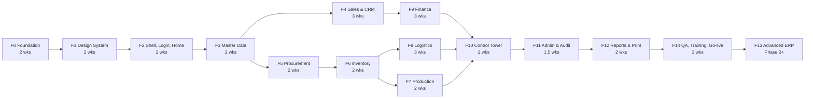

# NeoBus Web Frontend — Master Plan Index

> **Document set:** `docs/Frontend/` · **Version:** 1.0 (2026-11-12) · **Status:** PLAN — no code generated
> **Audience:** Product owner, frontend team, backend team, QA, trainers
> **Scope:** The browser-based web application ("NeoBus Office") for OWNER, OPS_COORD, and a touch-friendly "Floor Mode" for PROD_MGR and STOREKEEPER. Native Flutter apps for DRIVER/COLLECTOR stay out of scope (`apps/mobile`), but the web gives managers full visibility of their work.

---

## 1. Why this plan exists

The backend (`apps/api`, NestJS modular monolith, modules M0–M7b) is complete and tested: **~35 HTTP controllers, ~230 endpoints, 85+ tables, 12 exception types, 7 materialized dashboard views**. The current `apps/web` contains **logic-only TypeScript "desk" stores** and **one static HTML prototype** (`public/control-tower.html`) served by a zero-dependency Node script. There is **no real routed, production-grade web application** that a non-technical employee can use every day.

This plan defines that application, phase by phase, so it:

1. Covers **every backend capability** that exists today (nothing built in the API is left without a screen).
2. Adds the **standard ERP capabilities** found in Odoo, ERPNext, Zoho, SAP Business One, Tally/Busy-style Indian ERPs — marked clearly as *"needs backend"* where the API does not yet support them.
3. Is designed for **non-technical staff**: guided flows, plain language, big clear actions, colour + icon status, contextual help, undo-safe actions and no jargon.
4. Looks **modern, attractive and informative**: KPI cards, charts, timelines, progress meters, live status — not grey forms.

---

## 2. Document map (read in order)

| # | File | What it covers |
|---|------|----------------|
| 00 | `00_FRONTEND_PLAN_INDEX.md` | This file — map, phase timeline, conventions |
| 01 | [`01_CODEBASE_REVIEW_AND_GAP_ANALYSIS.md`](./01_CODEBASE_REVIEW_AND_GAP_ANALYSIS.md) | What exists in the repo, API inventory per module, issues found, gaps |
| 02 | [`02_PHASE_F0_FOUNDATION_AND_TECH_STACK.md`](./02_PHASE_F0_FOUNDATION_AND_TECH_STACK.md) | Stack, monorepo layout, API client, auth/session, state, error handling, CI |
| 03 | [`03_PHASE_F1_DESIGN_SYSTEM_AND_USABILITY.md`](./03_PHASE_F1_DESIGN_SYSTEM_AND_USABILITY.md) | Visual language, components, "non-tech friendly" UX rules, help system, i18n, accessibility |
| 04 | [`04_PHASE_F2_APP_SHELL_LOGIN_AND_HOME.md`](./04_PHASE_F2_APP_SHELL_LOGIN_AND_HOME.md) | Login, app shell, navigation, role home pages, global search, notifications, approvals inbox |
| 05 | [`05_PHASE_F3_MASTER_DATA_AND_SETUP.md`](./05_PHASE_F3_MASTER_DATA_AND_SETUP.md) | Items, UoM, customers, suppliers, vehicles, sites, users, setup wizard, imports |
| 06 | [`06_PHASE_F4_SALES_AND_CRM.md`](./06_PHASE_F4_SALES_AND_CRM.md) | Daily price sheet, quotes, quick order, order tracker, Customer 360, CRM |
| 07 | [`07_PHASE_F5_PROCUREMENT_AND_SUPPLIERS.md`](./07_PHASE_F5_PROCUREMENT_AND_SUPPLIERS.md) | Requisitions, POs, GRN, shortfalls, supplier bills, scorecards |
| 08 | [`08_PHASE_F6_INVENTORY_AND_WAREHOUSE.md`](./08_PHASE_F6_INVENTORY_AND_WAREHOUSE.md) | Stock, ATP, batches/FEFO, expiry, transfers, adjustments, ledger, Floor Mode |
| 09 | [`09_PHASE_F7_PRODUCTION_AND_FACTORY.md`](./09_PHASE_F7_PRODUCTION_AND_FACTORY.md) | BOMs, work orders, Kanban, consumption/output, wastage, attendance, RM requisitions |
| 10 | [`10_PHASE_F8_LOGISTICS_AND_FLEET.md`](./10_PHASE_F8_LOGISTICS_AND_FLEET.md) | Vehicles, trip builder, dispatch board, challans, ePOD view, issues, expenses, trip close |
| 11 | [`11_PHASE_F9_FINANCE_AND_ACCOUNTS.md`](./11_PHASE_F9_FINANCE_AND_ACCOUNTS.md) | Invoices, AR, collections, handover, cheques, credit notes, COD, PTP, EOD, Tally, opening balances |
| 12 | [`12_PHASE_F10_CONTROL_TOWER_APPROVALS_ANALYTICS.md`](./12_PHASE_F10_CONTROL_TOWER_APPROVALS_ANALYTICS.md) | Owner Control Tower, pulse, status matrix, KPIs, analytics, stock alerts, approvals centre |
| 13 | [`13_PHASE_F11_ADMIN_SETTINGS_AND_AUDIT.md`](./13_PHASE_F11_ADMIN_SETTINGS_AND_AUDIT.md) | Users & roles, sites & locations, business rules, approval policies, templates, audit trail |
| 14 | [`14_PHASE_F12_REPORTS_PRINTING_AND_DOCUMENTS.md`](./14_PHASE_F12_REPORTS_PRINTING_AND_DOCUMENTS.md) | Report library, GST reports, exports, print/PDF, document vault, scheduled digests |
| 15 | [`15_PHASE_F13_ADVANCED_ERP_EXTENSIONS.md`](./15_PHASE_F13_ADVANCED_ERP_EXTENSIONS.md) | Phase-2+ ERP features: HR/payroll, CRM pipeline, customer portal, QC, maintenance, budgets, assets, BI, AI assist |
| 16 | [`16_PHASE_F14_QUALITY_TRAINING_AND_ROLLOUT.md`](./16_PHASE_F14_QUALITY_TRAINING_AND_ROLLOUT.md) | Testing, performance, security, UAT, training, in-app onboarding, go-live, support |
| 17 | [`17_BACKEND_API_GAP_REGISTER.md`](./17_BACKEND_API_GAP_REGISTER.md) | Consolidated list of API endpoints the frontend needs that do not yet exist |

---

## 3. Phase timeline (recommended)

Assumes a team of **2–3 frontend developers + 1 designer (part-time) + 1 backend developer** for gaps. Durations are working weeks and overlap where possible.

| Release | Phases | Outcome | Target users |
|---------|--------|---------|--------------|
| **R1 — "Run the day"** (MVP, ~12 wks) | F0, F1, F2, F3, F4, F9 (core), F10 (pulse + approvals) | Take orders, approve exceptions, invoice, collect cash, close the day | Owner, Ops Coordinator |
| **R2 — "Run the supply chain"** (~8 wks) | F5, F6, F7, F8, Floor Mode | Buy, receive, store, produce, deliver | + Production Manager, Storekeeper |
| **R3 — "Run the business"** (~6 wks) | F10 (analytics), F11, F12, F14 | Analytics, admin self-service, reports, full training & go-live | All office roles |
| **R4 — "Grow"** (Phase 2+) | F13 | HR, CRM pipeline, customer portal, QC, assets, BI | Expanded team |

---

## 4. Guiding principles (apply to every phase)

| # | Principle | What it means on screen |
|---|-----------|-------------------------|
| P1 | **Exception-first** | Each home page leads with "what needs you now" (approvals, overdue, blocked), not a menu |
| P2 | **One screen, one job** | Each page has one big primary button; secondary actions in a "More" menu |
| P3 | **Plain language** | "Waiting for Owner approval" not `PENDING_APPROVAL`; "Money to collect" not "AR" (with the term shown as a tooltip) |
| P4 | **Show, don't make them think** | Colour + icon + word for every status; progress bars; mini-charts on KPI cards |
| P5 | **Guide every multi-step task** | Steppers/wizards for order entry, PO, trip building, EOD close |
| P6 | **Safe by default** | Confirm dialogs that explain consequences; reversals instead of delete; drafts autosave |
| P7 | **Server is the authority** | Money, margin, stock, credit, approvals always come from API; client previews are labelled "preview" |
| P8 | **Role-shaped UI** | Users only see menus and fields they are allowed to use (permissions from `/auth/me`); price fields are hidden for masked roles |
| P9 | **Fast for experts too** | Keyboard shortcuts, command palette (Ctrl+K), saved filters — without confusing beginners |
| P10 | **Help everywhere** | `?` tooltips, empty-state guidance, short videos, guided tours per screen |

---

## 5. Status legend used in all files

| Tag | Meaning |
|-----|---------|
| ✅ **API ready** | Backend endpoint exists today — UI can be built directly |
| 🟡 **API partial** | Endpoint exists but needs filters/fields/pagination added |
| 🔴 **Needs backend** | No endpoint yet — listed in `17_BACKEND_API_GAP_REGISTER.md` |
| 🔵 **Phase 2+** | Standard ERP feature planned for later release (F13) |

## 6. Conventions

- Routes use kebab-case: `/sales/orders/new`.
- All API calls go to `/api/v1/...` (global prefix set in `apps/api/src/main.ts`).
- Money displayed as `₹1,00,000.00` (Indian grouping), dates `12 Nov 2026, 10:30 AM` IST.
- Each phase file has the same layout: **Goal → Users → Screens → Features → UX for non-tech users → API mapping → Gaps → Acceptance criteria → Task checklist**.

## 7. Relationship to existing docs

| Existing doc | Relationship |
|--------------|--------------|
| `docs/claude/10_FE_Web_Frontend.md` | Original frontend spec (screens per blueprint). This plan **supersedes and extends** it with full ERP scope and non-tech UX |
| `docs/Copilot/04_PHASE_P3_FRONTEND_PRODUCT_DELIVERY.md` | P3 milestone plan. Its F0–F9 checklist was marked done against logic-only stores; this plan turns those into a real, shippable UI |
| `docs/OPEN_DECISIONS.md` | OD-001…OD-025 are **CONFIRMED** and respected here (e.g. OD-008 English MVP + i18n-ready, OD-021 30 s refresh, OD-005 manual e-way bill ≥ ₹50k) |

