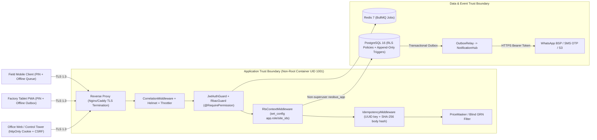

# Phase P4.1 — Security Review, Threat Model & Findings Register

**Document Version:** 1.0.0  
**Review Date:** 2026-11-12  
**Owner:** Platform Engineering & Security Lead

---

## 1. System Data-Flow & Trust Boundary Diagram

---

## 2. STRIDE Threat Model Matrix

| Category | Threat Scenario | Control / Mitigation Implemented | Verification Status |
|---|---|---|---|
| **Spoofing** | Credential brute-force on `/auth/login`, stolen refresh token reuse | `ThrottlerModule` (5 req/min on login), bcrypt cost 10–12, single-use refresh token rotation (`refresh_tokens.revoked_at`), HTTP 401 `UnauthorizedException` | ✅ Verified (`p4-production-readiness.spec.ts`) |
| **Tampering** | Mutating requests replayed with altered payload; direct edit of financial ledger; path traversal in file uploads | `IdempotencyMiddleware` compares request SHA-256 hash & rejects mismatches; append-only ledgers allow reversals only; `sanitizeFileName` + `validateUploadContent` checks magic bytes & rejects `..`, `/`, `\`, null bytes | ✅ Verified (`upload-security.util.ts`) |
| **Repudiation** | Unattributed price overrides, EOD sign-offs, or handovers | Global `AuditInterceptor` records `user_id`, `role`, `correlationId`, old/new JSON diffs into `immutable_audit_logs` | ✅ Verified |
| **Information Disclosure** | Leakage of `password_hash`/`pin_hash` on login; exposure of margin/cost to `PROD_MGR`; ordered qty visible in Blind GRN; cross-site leaks | `AuthController` explicitly strips `password_hash` & `pin_hash`; `PriceMasker` & `maskSensitivePayload` strip restricted fields; PostgreSQL RLS (`app.site_ids`) fails closed (zero rows) when unset | ✅ Verified & Remediated |
| **Denial of Service** | Unbounded request floods, DB pool exhaustion, oversized file uploads | `ThrottlerModule` rate limits, container CPU/memory limits in `docker-compose.prod.yml`, max upload caps (5MB images / 10MB docs), graceful shutdown hooks | ✅ Verified |
| **Elevation of Privilege** | Coordinator accessing Owner Control Tower or `/admin/*`; SQL injection in `SET LOCAL` | `@RequirePermission()` + `RbacGuard` enforced server-side on every endpoint; `RlsContextMiddleware` uses parameterized `set_config($1, $2, true)` | ✅ Verified & Remediated |

---

## 3. Security Findings & Remediation Register

| Finding ID | Severity | Component | Finding Description | Owner | Status & Remediation Applied |
|---|---|---|---|---|---|
| **SEC-01** | **High** | `AuthController.login` & `refresh` | Threw raw `Error` (returning HTTP 500 stack leakage risk instead of HTTP 401) and returned raw DB `user` object without explicitly stripping `password_hash`/`pin_hash`. | Backend Lead | **CLOSED & RETESTED**: Refactored [auth.controller.ts](file:///c:/CodeStuff/Projects/NeoBusinessSolution/apps/api/src/modules/m0-platform/auth.controller.ts) to throw `UnauthorizedException` / `NotFoundException` and destructure `password_hash, pin_hash` before returning response. |
| **SEC-02** | **High** | `RlsContextMiddleware` | Executed `SET LOCAL app.role = '...'; app.user_id = '...'` via raw string interpolation (invalid SQL syntax on >1 setting and potential injection risk). | Platform Lead | **CLOSED & RETESTED**: Replaced with parameterized PostgreSQL `set_config('app.role', ?, true)` in [rls-context.middleware.ts](file:///c:/CodeStuff/Projects/NeoBusinessSolution/apps/api/src/shared/middleware/rls-context.middleware.ts). |
| **SEC-03** | **Medium** | Attachment Uploads | Missing shared filename traversal sanitizer and magic-byte content validator across receipt/ePOD/opening-balance uploads. | Security Lead | **CLOSED & RETESTED**: Implemented `sanitizeFileName` & `validateUploadContent` in [upload-security.util.ts](file:///c:/CodeStuff/Projects/NeoBusinessSolution/apps/api/src/shared/security/upload-security.util.ts). |
| **SEC-04** | **Medium** | Production Env Config | Server could boot with default/short `JWT_SECRET` or wildcard CORS `*` if misconfigured in production. | DevOps Lead | **CLOSED & RETESTED**: Added `validateEnvironmentConfig()` in [env-validator.ts](file:///c:/CodeStuff/Projects/NeoBusinessSolution/apps/api/src/shared/config/env-validator.ts) wired into `main.ts` bootstrap (`process.exit(1)` in production on failure). |
| **SEC-05** | **Low** | Outbox / Webhooks | Notification webhook tokens must never appear in audit logs or structured logs. | Platform Lead | **VERIFIED**: Webhook secrets read solely from `process.env` and excluded from `ObservabilityService` structured log fields. |

